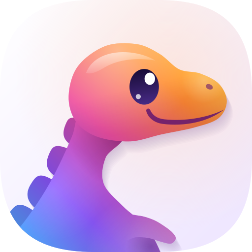
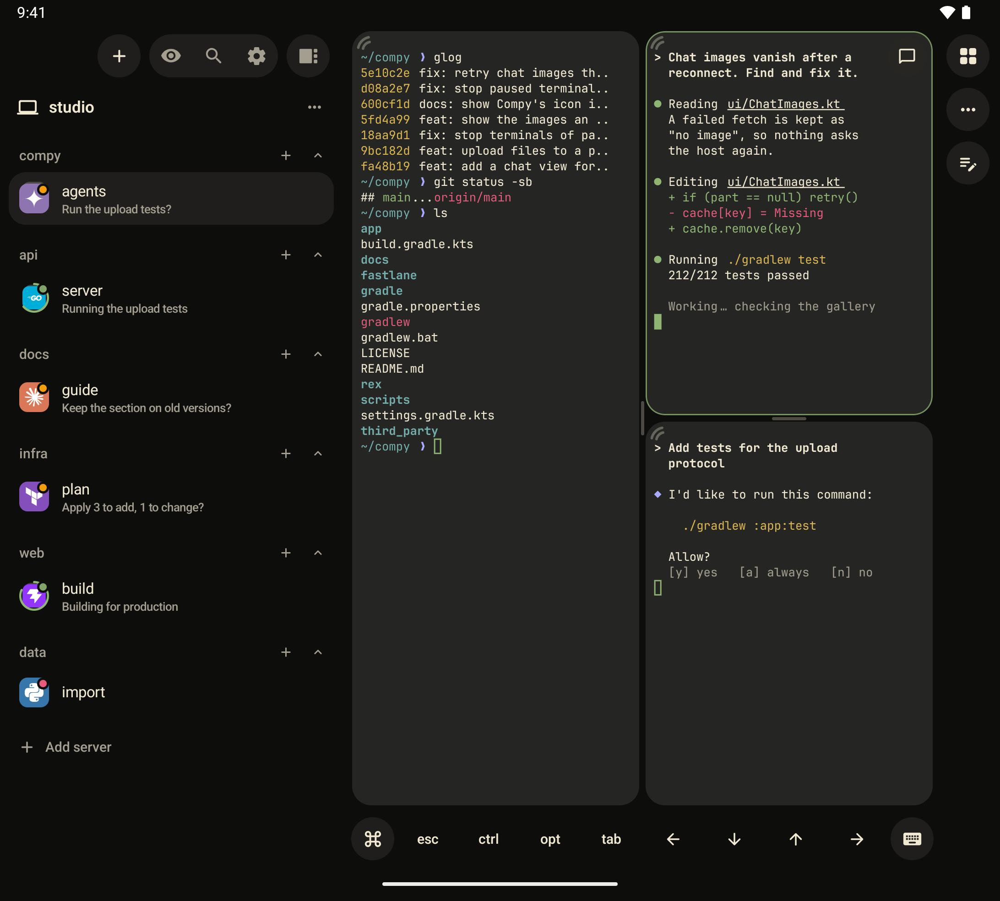
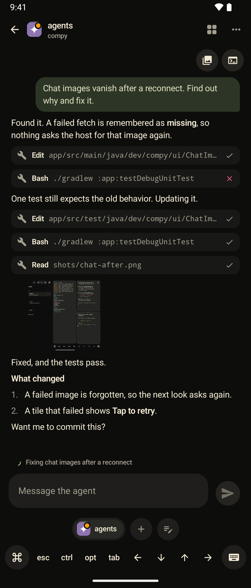
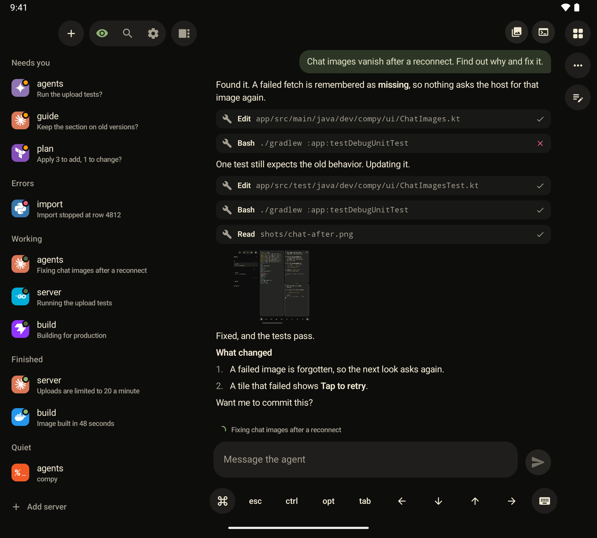
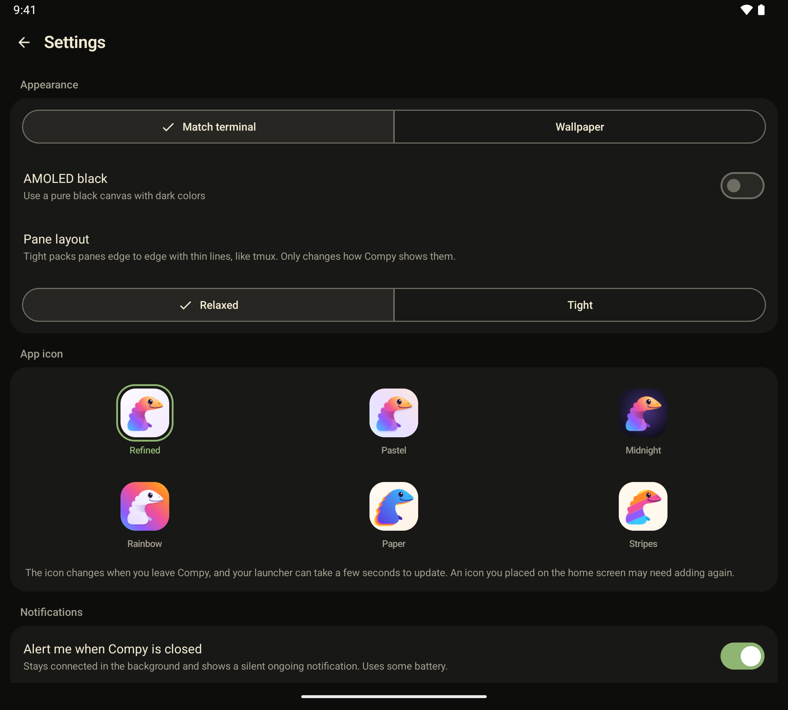

<p align="center"></p>

# Compy

An unofficial, native Android client for [Rex](https://rex.superlogical.com), written in Kotlin
with Jetpack Compose. It shows a Rex server's sessions, windows and panes on a phone, a foldable
or a tablet, with live terminals drawn through libghostty-vt, and adds what you need to run
coding agents away from your desk. Not affiliated with the makers of Rex.



## What it does

- **Your Rex sessions, as they are.** Sessions, windows and panes live on the Rex server, so they
  are the same here and in the Rex app. Compy draws Rex's real split layout, and what you change
  reaches every connected client. Drag a divider to resize. Drag a pane by its corner to move or
  swap it, or onto the trash can to close it. Press empty space and drag onto a pane to split it
  where the highlight shows. Panes can also float, be minimized to a tray, or be detached to keep
  running outside any window.
- **Fast terminals.** Text is drawn with libghostty-vt, with scrollback, find, links you can tap,
  your own font, and a haptic on the bell. When the shell marks its prompts with OSC 133, jump
  between them or copy a command's output. Each session either fits its terminals to this screen,
  or keeps another device's size and lets you pan and zoom.
- **An eye on your agents.** Windows show their program's icon, a status dot, a progress ring and
  the current folder. The Activity view sorts every pane on every server into Needs you, Errors,
  Working, Finished and Quiet. Compy stays connected in the background and tells you when an agent
  needs you, finishes or fails: open the pane from the notification, or reply without opening
  Compy. A home screen widget and a Quick Settings tile show the same at a glance.
- **Agents as a chat.** Tap the bubble in the corner of a Claude Code pane to read its
  conversation as a chat instead of a terminal. Replies are formatted, each tool call folds into
  one line with a ✓ or ✗, images the agent read show as thumbnails with a full-screen viewer and a
  gallery, and you can type a message back. It needs a one-time
  [setup on the host](#setting-up-agent-chat).
- **Folded or unfolded.** On a narrow screen, such as a phone or a foldable's cover, the list and
  the panes take turns. On a wide one, such as an unfolded foldable or a tablet, they sit side by
  side. Unfolding moves from one to the other without losing your place.
- **Made for a touchscreen.** A key bar you can customize, sticky modifiers, and a composer with
  voice typing. Tap `⌘` for a searchable palette of Compy's commands and the host's Rex actions,
  or hold it to latch the modifier. Hardware keyboards and mice work too, and so does predictive
  back.
- **Files and text from other apps.** Share files to Compy, or use **Upload files…** in a pane's
  menu. They are copied to that pane's computer and their paths typed into the terminal, ready to
  hand to an agent. Shared text is pasted into the pane you pick.
- **Several servers.** All your Rex servers in one list, reached over Tailscale. App shortcuts
  jump straight back into a recent session.
- **Your look, kept private.** The app takes its colors from the host's terminal theme or from
  your wallpaper, and there are six app icons. No telemetry, a biometric lock when the device
  supports it, and optional screenshot blocking.

| An agent's conversation as a chat | The Activity view | Alerts, and the tile |
|---|---|---|
|  |  |  |





With background alerts off, Compy only stays connected while it's open, and the widget and tile
show the last known state, with its age.

## Installing

You need Android 14 or later, and a Rex server to connect to; see
[Rex's documentation](https://www.superlogical.com/rex/docs). Compy reaches servers over
Tailscale.

1. Download the latest APK from the [releases page](../../releases) and open it. These are test
   builds for now. Or [build it yourself](#building).

2. Install the Tailscale app on your phone and join the same tailnet as the computer running Rex.

3. On that computer, serve Rex over the tailnet and show a pairing code:

   ```sh
   rex server tailscale on
   rex server tailscale pair
   ```

4. In Compy, tap **Scan pairing code** and scan what it shows, or type the `ts.net` address.

Release builds only use HTTPS. Sending files to a pane needs Rex with API revision 11 or later on
the host.

### Setting up agent chat

Rex doesn't share agents' conversations with clients, so Compy reads them through a small action
you add to the host's Rex config. On the computer running Rex, copy
[`rex/compy.lua`](rex/compy.lua) next to your `init.lua` and load it from there:

```sh
cp rex/compy.lua ~/.config/rex/compy.lua
echo 'dofile(os.getenv("HOME") .. "/.config/rex/compy.lua")' >> ~/.config/rex/init.lua
rex config reload
```

The actions find the transcript of the agent running in a pane (Claude Code for now) and return
part of it, or one of its images. They read nothing else: the pane's agent decides the file, and
callers can't name one.

When a Compy release changes `compy.lua`, copy it again and run `rex config reload`. Images need
the version from Compy 0.2.9 or later.

## Building

You need JDK 21, the Android SDK (platform 37, NDK 27.1, CMake 3.22) and Zig 0.17.

```sh
git clone --recurse-submodules <the address of this repository> compy
cd compy
./gradlew :app:assembleDebug
adb install app/build/outputs/apk/debug/app-debug.apk
```

Gradle builds libghostty-vt from the pinned `third_party/ghostty` submodule. Debug builds also
accept `http://` addresses, for a local test server:

```sh
rex server run --listen http://127.0.0.1:18765 --allow-anonymous
# In the emulator, connect to http://10.0.2.2:18765
```

`--allow-anonymous` gives every connection full access, so only use it on loopback.

Signing and publishing a release is described in [docs/RELEASING.md](docs/RELEASING.md).

## Layout

| Path | What it holds |
|---|---|
| `app/src/main/java/dev/compy/` | Where the app starts, and the state its screens share |
| `…/ui/` | The session list, the workspace and its panes, agent chat, the command palette, the key bar, settings and themes |
| `…/term/` | The terminal view, the terminal model on libghostty-vt, keys, links, fonts |
| `…/rex/` | The Rex protocol: control connection, terminal streams, layout model, uploads, agent transcripts |
| `…/system/` | What runs outside the app's screens: alerts, the background connection, the widget, the tile, sharing, app icons and shortcuts |
| `…/data/` | Settings |
| `app/src/main/cpp/` | The bridge from Kotlin to libghostty-vt |
| `app/src/main/assets/` | Bundled fonts and program icons |
| `rex/compy.lua` | The Rex actions agent chat needs on the host |
| `scripts/` | The libghostty-vt build, and generators for the app and program icons |
| `fastlane/` | The store listing and changelogs |
| `docs/` | How to release, and these screenshots |
| `third_party/ghostty` | Ghostty, for its terminal library |

Compy uses Rex's documented API, which any server serves at `/llms.txt`: a JSON control WebSocket
at `/api/control`, and a binary terminal stream at `/api/data`. Each stream starts with a Ghostty
snapshot, followed by raw program output. If a future Rex sends a snapshot Compy can't decode,
Compy shows the current screen without history and says so.

Program icons are open icons from [Simple Icons](https://simpleicons.org), listed in
`app/src/main/assets/icons/ATTRIBUTION.md`. To change the list, edit and run
`scripts/generate-program-icons.py`.

## License

Apache 2.0; see [LICENSE](LICENSE). Bundled fonts and icons keep their own licenses, noted beside
them: the JetBrains Mono Nerd Font and Noto symbol fonts are under the SIL Open Font License.
libghostty-vt is MIT.
