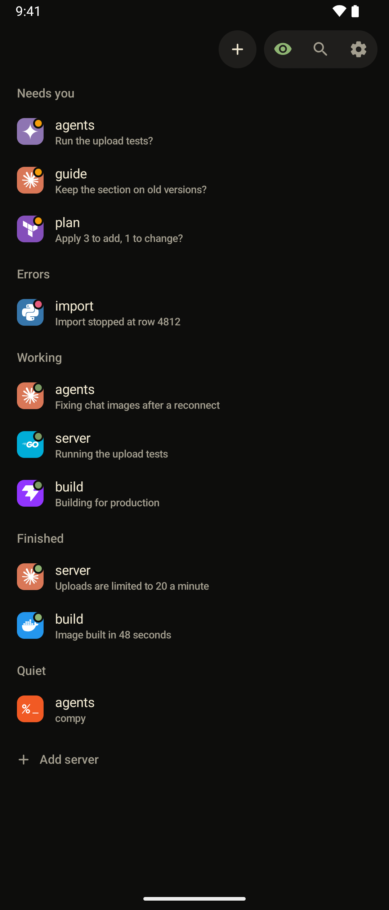
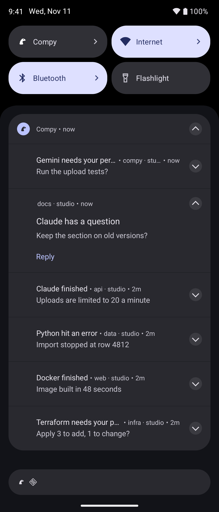

<p align="center"></p>

# Compy

An unofficial, native Android client for [Rex](https://rex.superlogical.com), written in Kotlin
with Jetpack Compose. It shows a Rex server's sessions, windows and panes on a phone, a foldable
or a tablet, with live terminals drawn through libghostty-vt.


## What it does

- **Your Rex sessions, as they are.** Sessions, windows and panes live on the Rex server, so they
  are the same here and in the Rex app. Drag panes to resize, move, split or close them, and keep
  all your servers in one list.
- **Fast terminals.** Text is drawn with libghostty-vt, with scrollback, find, links and your own
  font. A key bar and a command palette make them usable by touch.
- **An eye on your agents.** The Activity view sorts every pane into Needs you, Errors, Working,
  Finished and Quiet. Compy tells you when an agent needs you, finishes or fails, and you can
  reply from the notification. A widget and a Quick Settings tile show the same.
- **Agents as a chat.** Read a Claude Code pane as a conversation instead of a terminal, and type
  back. It needs a one-time [setup on the host](#agent-chat).
- **Files from other apps.** Share files or text to Compy and they go to the pane you pick.
- **Private.** No telemetry, a biometric lock, and optional screenshot blocking.

| An agent's conversation as a chat | The Activity view | Alerts, and the tile |
|---|---|---|
|  |  |  |


## Installing

You need Android 14 or later, and a Rex server to connect to; see
[Rex's documentation](https://www.superlogical.com/rex/docs). Compy reaches servers over
Tailscale.

1. Download the latest APK from the [releases page](../../releases) and open it. These are test
   builds for now. Or [build it yourself](#building).

2. Install the Tailscale app on your phone and join the same tailnet as the computer running Rex.

3. On that computer, serve Rex over the tailnet and show a pairing code:

   ```sh
   rex server tailscale on
   rex server tailscale pair
   ```

4. In Compy, tap **Scan pairing code** and scan what it shows, or type the `ts.net` address.

Sending files to a pane needs Rex with API revision 11 or later on the host.

### Agent chat

Rex doesn't share agents' conversations with clients, so Compy reads them through a small action
on the host. Copy [`rex/compy.lua`](rex/compy.lua) next to your `init.lua` and load it:

```sh
cp rex/compy.lua ~/.config/rex/compy.lua
echo 'dofile(os.getenv("HOME") .. "/.config/rex/compy.lua")' >> ~/.config/rex/init.lua
rex config reload
```

It reads only the transcript of the agent running in a pane. When a Compy release changes
`compy.lua`, copy it again and run `rex config reload`.

## Building

You need JDK 21, the Android SDK (platform 37, NDK 27.1, CMake 3.22) and Zig 0.17.

```sh
git clone --recurse-submodules <the address of this repository> compy
cd compy
./gradlew :app:assembleDebug
adb install app/build/outputs/apk/debug/app-debug.apk
```

Debug builds also accept `http://` addresses, for a local test server. Signing and publishing a
release is described in [docs/RELEASING.md](docs/RELEASING.md).

## Layout

| Path | What it holds |
|---|---|
| `app/src/main/java/dev/compy/` | Where the app starts, and the state its screens share |
| `…/ui/` | The session list, the workspace and its panes, agent chat, the command palette, the key bar, settings and themes |
| `…/term/` | The terminal view, the terminal model on libghostty-vt, keys, links, fonts |
| `…/rex/` | The Rex protocol: control connection, terminal streams, layout model, uploads, agent transcripts |
| `…/system/` | What runs outside the app's screens: alerts, the background connection, the widget, the tile, sharing, app icons and shortcuts |
| `…/data/` | Settings |
| `app/src/main/cpp/` | The bridge from Kotlin to libghostty-vt |
| `app/src/main/assets/` | Bundled fonts and program icons |
| `rex/compy.lua` | The Rex actions agent chat needs on the host |
| `scripts/` | The libghostty-vt build, and generators for the app and program icons |
| `fastlane/` | The store listing and changelogs |
| `docs/` | How to release, and these screenshots |
| `third_party/ghostty` | Ghostty, for its terminal library |

## License

Apache 2.0; see [LICENSE](LICENSE). Bundled fonts and icons keep their own licenses, noted beside
them.
